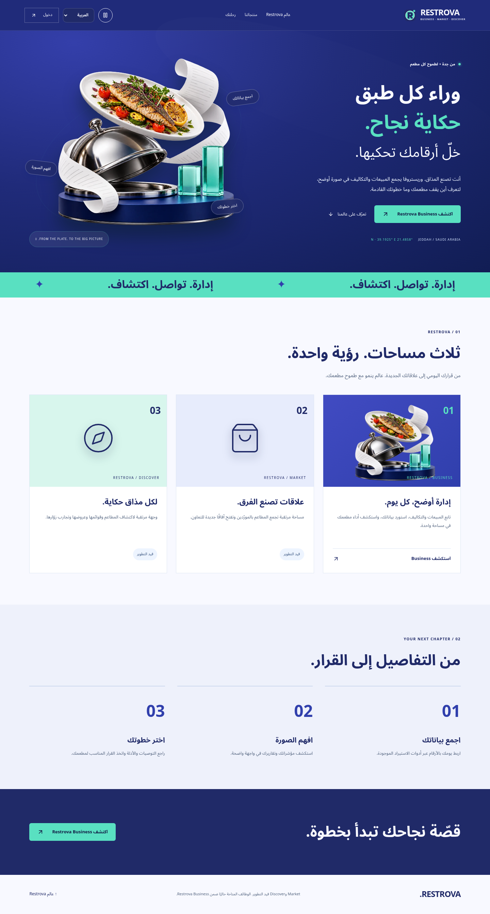
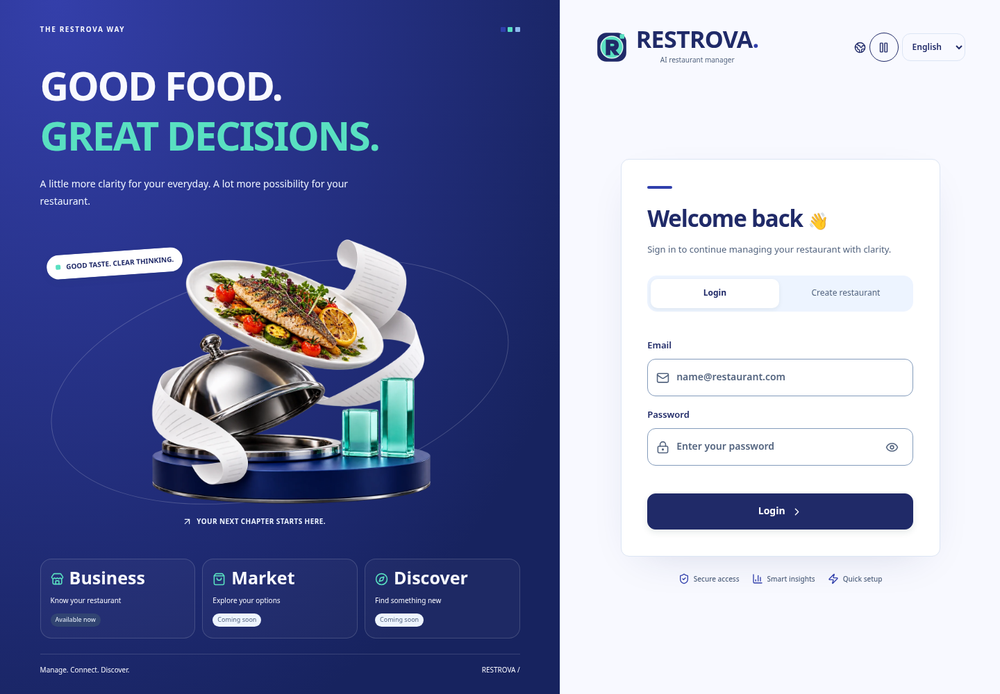
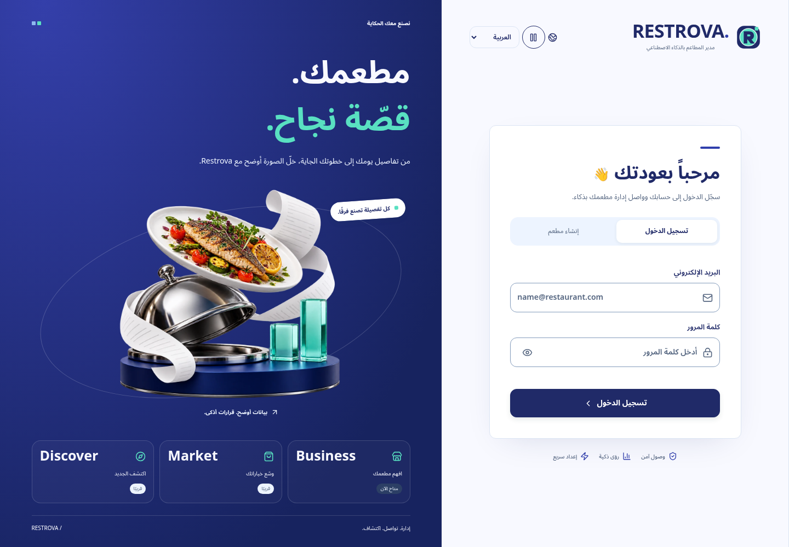
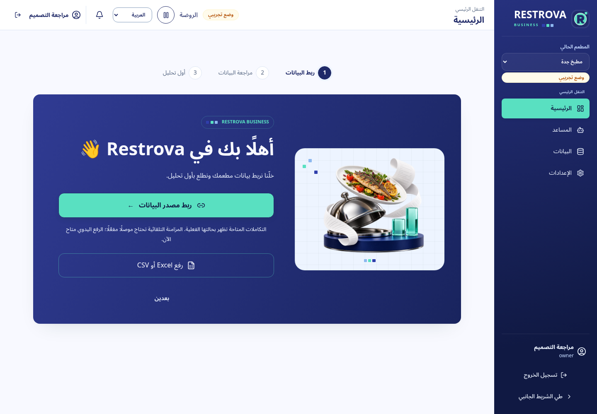
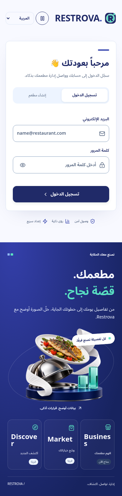

# Restrova indigo and mint preview

These screenshots show the running local application with the current restaurant-focused
identity. The legacy filename is retained for existing links. They do not establish a live
Render deployment. The Business workspace uses a synthetic review tenant without customer data.

The interface uses deep indigo, mint, realistic restaurant objects and readable Arabic
headlines. The cartoon mascot has been replaced. The workspace retains quiet surfaces for
financial values, tables and forms. Screenshots do not demonstrate animation; the application
includes a motion control and respects reduced-motion preferences.

Browser verification covered 36 public-page states (Arabic, English and Chinese at 320,
390, 768 and 1440 pixels), 28 authenticated Business route/viewport states, and 20
static/offline gallery selections. No JavaScript page errors, missing visible images or
horizontal document overflow were observed. Motion pause, reduced-motion preference and
the unauthenticated route guard were also checked. These checks use local synthetic data.

## Arabic homepage

## English login

## Arabic login

## Business workspace

## Mobile login

